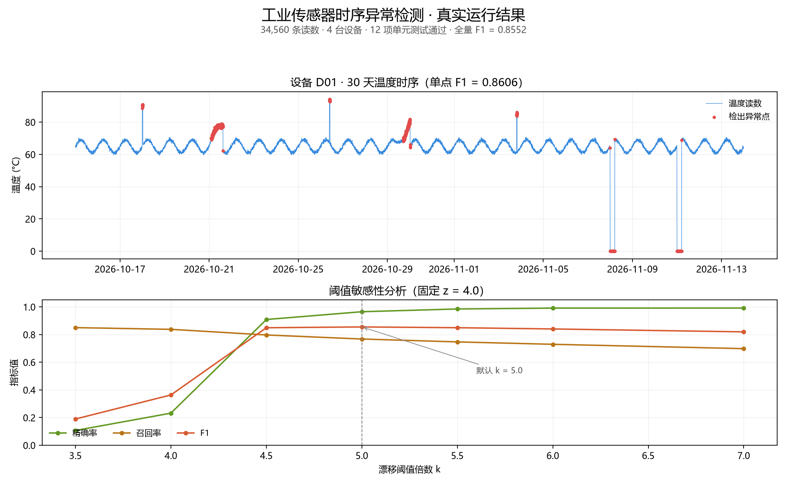

# 工业传感器时序异常检测看板

> 二期进行中 · 2026.11 – 至今（预计 2026.12 完成）

一个面向工业设备时序数据的轻量异常检测项目：生成模拟传感器读数，用**两级检测**识别尖峰、缓慢漂移、断连三类故障，并通过 REST API 与 Web 看板输出可解释的告警区间。

数据为程序生成的模拟数据，**不含任何真实企业信息或密钥**，可安全公开。



## 为什么做这个

模拟产线设备的温度/振动传感器读数在工业场景中很常见，异常检测是设备预测性维护的基础模块。本项目把「数据生成 → 检测算法 → 接口服务 → 可视化 → 测试评估」串成一条完整链路，刻意保持小而完整：每个模块都能单独运行、单独验证，也便于替换成真实数据。

## 快速开始

```bash
# 1. 建议先建虚拟环境（Windows）
python -m venv .venv
.venv\Scripts\activate
pip install -r requirements.txt

# 2. 生成数据并跑通检测
python data_gen.py
python detect.py

# 3. 跑测试
python -m unittest discover -s tests -v

# 4. 启动 REST API（可选）
uvicorn api:app --reload          # http://127.0.0.1:8000/docs

# 5. 启动 Web 看板（可选，另开一个终端）
streamlit run app.py              # http://localhost:8501
```

只想验证核心算法时，**不需要装任何额外依赖**——`data_gen.py` / `detect.py` / 测试只用到 `numpy` 和 `pandas`。

## 目录结构

```
sensor-anomaly-dashboard/
├── data_gen.py              模拟传感器数据与故障标签生成
├── detect.py                两级检测、告警区间合并、指标评估
├── api.py                   FastAPI 接口层
├── app.py                   Streamlit 可视化看板（阈值可实时调整）
├── tests/test_pipeline.py   12 项单元测试
├── docs/
│   ├── overview.png         真实运行结果效果图
│   └── make_figure.py       效果图的生成脚本（需 matplotlib）
├── data/                    运行后生成 CSV（已加入 .gitignore）
├── requirements.txt
├── .gitignore
└── LICENSE
```

## 分步实施与验收

| 步骤 | 命令 / 动作 | 验收标准 |
|---|---|---|
| 0 | 建虚拟环境并 `pip install -r requirements.txt` | `python -c "import numpy, pandas"` 不报错 |
| 1 | `python data_gen.py` | 打印 34,560 条读数、4 台设备；`data/` 下出现两个 CSV |
| 2 | `python detect.py` | 打印 27 段告警与精确率/召回率/F1；生成 `data/anomalies.csv` |
| 3 | `python -m unittest discover -s tests -v` | 12 项全部 `ok` |
| 4 | `uvicorn api:app --reload`，访问 `/docs` | 4 个接口可见，`/api/health` 返回 `status: ok` |
| 5 | `streamlit run app.py` | 浏览器出现曲线、红色异常点、告警表；拖动阈值滑块有变化 |
| 6 | 截图存到 `docs/dashboard.png`，写进简历 | 仓库首屏可读、项目能在 30 秒内讲清 |

> 建议自己动手改一次 `Z_THRESHOLD` 和 `DRIFT_K`，观察精确率与召回率如何反向变化——这是电话交流时最容易被问到、也最能体现理解的一处。

## 检测算法

**第一级：局部突变。** 用滑动窗口中位数与 MAD（绝对中位差）计算稳健 z 分数：

```
z(t) = |x(t) - median(window)| / max(1.4826 × MAD(window), 0.5)
```

中位数与 MAD 对离群点不敏感，不会被单个尖峰把阈值「带跑」；`1.4826` 把 MAD 换算成近似标准差，`0.5` 是防止平稳段除零的下限。`z > 4.0` 判为突变，主要抓尖峰与断连。

**第二级：缓慢漂移。** 漂移在局部窗口内看起来「一切正常」，单点 z 分数抓不到。因此改看 8 小时窗口中位数相对全局基线的偏移，阈值用一阶差分的 MAD 估计噪声尺度，而不是写死某个温度值：

```
sigma = 1.4826 × MAD(diff(x))
|median_8h(x) - median(x)| > k × sigma     (k = 5.0)
```

**后处理。** 连续异常点合并为告警区间，少于 2 点的孤立点视为噪声丢弃；再按区间特征标注为「尖峰 / 漂移 / 断连」。整个检测过程**不读取标签列**，标签只在评估环节使用。

## 实测结果

在 34,560 条读数（4 台设备 × 30 天 × 5 分钟采样，异常点占比 5.83%）上，默认参数 `z = 4.0, k = 5.0`：

| 指标 | 数值 |
|---|---|
| 精确率 Precision | 0.9651 |
| 召回率 Recall | 0.7679 |
| F1 | **0.8552** |
| 真阳性 / 误报 / 漏报 | 1,548 / 56 / 468 |
| 误报率 | 0.0016 |
| 检出告警区间 | 27 段 |
| 单元测试 | 12 项全部通过 |

对 `z ∈ [3.0, 5.0]`、`k ∈ [3.5, 6.0]` 共 30 组参数做网格搜索，最优组合 `z = 3.0, k = 5.0` 的 F1 为 0.8578，与默认组合仅差 0.0026。最终仍选 `z = 4.0`：工业场景误报会带来无效停机排查，4σ 是更保守也更好解释的取值。看板侧栏可以实时拖动这两个阈值复现该结论。

## 当前状态

| 阶段 | 内容 | 状态 |
|---|---|---|
| 一期 | 模拟数据生成、两级检测、REST 接口、Web 看板、单元测试与指标评估 | 已完成 |
| 二期 | 阈值敏感性实验、公开数据集对照、线上 Demo 部署 | 进行中 |
| 三期 | 与真实设备时序数据对接、异步告警 | 计划中 |

一期核心链路已可一键复现（见「快速开始」）；二期正在补充更严格的评估对照与可复现实验，预计 2026.12 完成。

## 仓库与复现

- GitHub：https://github.com/wwz666-wake/sensor-anomaly-dashboard
- `data/*.csv` 由脚本生成并已加入 `.gitignore`，clone 后执行 `python data_gen.py` 即可复现全部数据与指标
- 数据为程序生成的模拟值，不含任何真实企业信息或密钥

## 可拓展方向

如果后续想加深，优先做这三件，都很适合在面试里展开：接入真实公开数据集（如 NASA IMS 轴承数据）替换模拟数据；用 IsolationForest 做对照实验并比较误报；把告警推送改成异步任务与消息队列。

## License

MIT
